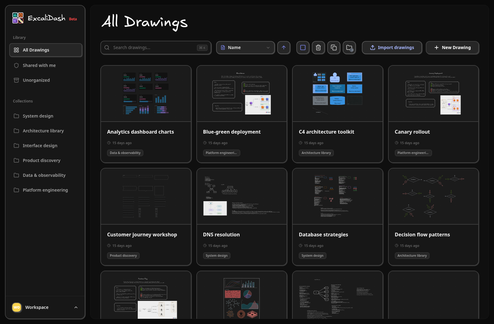

# ExcaliDash 中文增强版

[简体中文说明](./README.zh-CN.md) | Based on [upstream ExcaliDash v0.6.7](https://github.com/ZimengXiong/ExcaliDash/releases/tag/v0.6.7). This fork includes a complete Simplified Chinese interface and publishes `kinsanka/excalidash-backend` and `kinsanka/excalidash-frontend`.

Self-hosted Excalidraw workspaces with collections, real-time collaboration,
sharing, history, backups, and local or OpenID Connect authentication.

[](https://excalidash.xyz)

[Self-host Excalidraw with Docker Compose](https://excalidash.xyz/deploy/docker),
or read the documentation at [excalidash.xyz](https://excalidash.xyz).

## Quick start

```sh
git clone https://github.com/kinsanka/ExcaliDash_i18n_zh_CN.git
cd ExcaliDash_i18n_zh_CN
docker compose -f docker-compose.prod.yml up -d
```

Open <http://localhost:6767>. Configuration and deployment guidance live in
the [documentation](https://excalidash.xyz).

ExcaliDash is licensed under the GNU Lesser General Public License v3.0.
